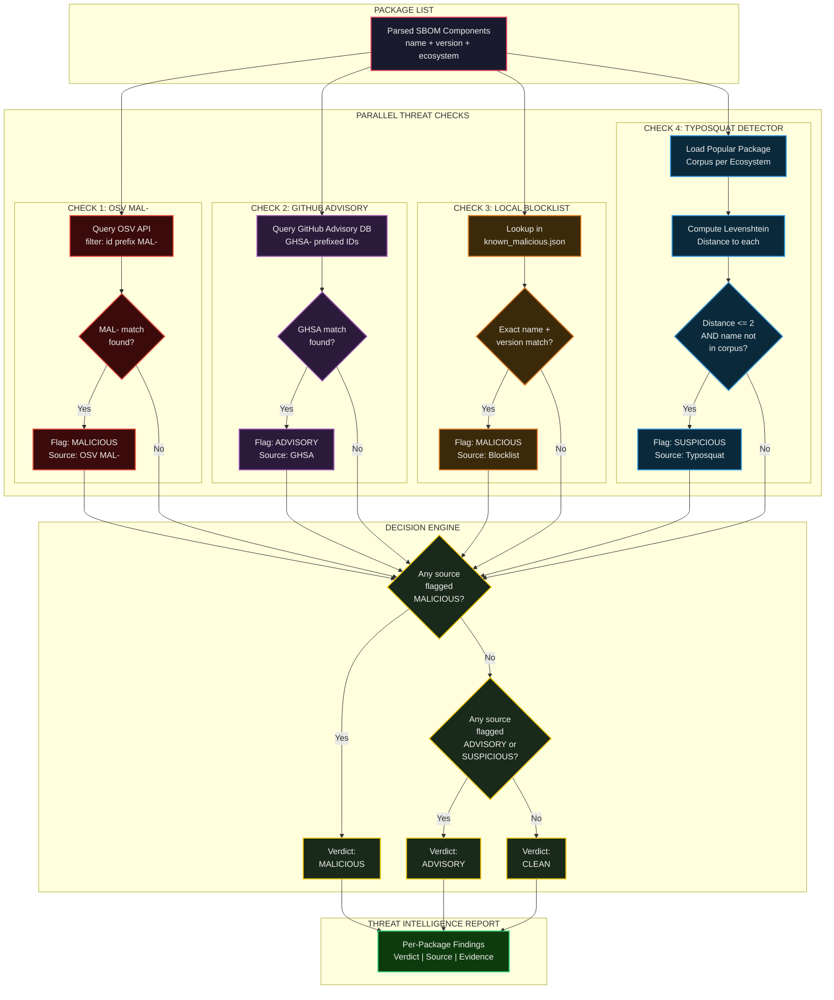

# Multi-Database Threat Intelligence Engine

> How Supply Chain Sentinel cross-references packages against four independent threat databases to detect known-malicious, advisory-flagged, and typosquatted dependencies.

[](../README.md)
[](./01-system-overview.md)

---

## Architecture Diagram



---

## Threat Database Details

### Check 1: OSV MAL- Advisories

The [OSV.dev](https://osv.dev) database maintains a dedicated class of advisories with the `MAL-` prefix. These are sourced from the [OpenSSF Malicious Packages](https://github.com/ossf/malicious-packages) repository and represent **confirmed malicious packages** identified by the open-source security community.

| Property | Detail |
|----------|--------|
| **Data Source** | OSV.dev + OpenSSF Malicious Packages |
| **ID Format** | `MAL-YYYY-NNNN` |
| **Query Method** | `POST /v1/query` with package name/version; filter response IDs starting with `MAL-` |
| **Signal Strength** | Definitive -- confirmed malicious by maintainers |
| **Coverage** | PyPI, npm, RubyGems, crates.io, NuGet, Go |

### Check 2: GitHub Advisory Database (GHSA)

The GitHub Advisory Database aggregates security advisories from multiple sources including NVD, package maintainers, and community reports. Advisories with the `GHSA-` prefix may indicate vulnerabilities that are **actively exploited** or have known malware associations.

| Property | Detail |
|----------|--------|
| **Data Source** | GitHub Advisory Database |
| **ID Format** | `GHSA-xxxx-xxxx-xxxx` |
| **Query Method** | Via OSV API (GHSA IDs are cross-listed) or GitHub GraphQL API |
| **Signal Strength** | High -- reviewed by GitHub security team |
| **Coverage** | All major ecosystems supported by GitHub |

### Check 3: Local Blocklist

A curated JSON file (`known_malicious.json`) containing packages confirmed malicious through incident response, blog posts, and security research. This list is manually maintained and updated with each release.

| Property | Detail |
|----------|--------|
| **Data Source** | Curated from security research, ReversingLabs, Phylum, Snyk blogs |
| **Format** | JSON map: `ecosystem -> [{ name, version, reason, reference_url }]` |
| **Query Method** | Exact match on `(ecosystem, name, version)` tuple |
| **Signal Strength** | Definitive -- manually verified entries |
| **Update Cadence** | With each Sentinel release; pull requests accepted |

### Check 4: Typosquat Detection

Typosquatting is a technique where attackers publish packages with names deliberately similar to popular legitimate packages (e.g., `requets` instead of `requests`). The detector computes the **Levenshtein edit distance** between each SBOM package name and a corpus of the top 5,000 packages per ecosystem.

| Property | Detail |
|----------|--------|
| **Algorithm** | Levenshtein (edit) distance |
| **Threshold** | Distance <= 2 AND the package name is NOT itself in the popular corpus |
| **Corpus Source** | Top 5,000 packages by weekly downloads per ecosystem |
| **Signal Strength** | Heuristic -- requires human or AI verification |
| **False Positive Rate** | Moderate; mitigated by the AI intent analysis in Stage 5 |

---

## Detection Techniques Summary

| Technique | Detects | Confidence | False Positive Risk |
|-----------|---------|------------|---------------------|
| OSV MAL- lookup | Confirmed malware packages | Very High | Very Low |
| GHSA cross-reference | Packages with known security advisories | High | Low |
| Blocklist exact match | Previously reported malware | Very High | None |
| Levenshtein typosquat | Name-confusion attacks | Medium | Moderate |

---

## Decision Logic

The decision engine applies a **priority cascade** to determine the final verdict for each package:

```
1. IF any source flags the package as MALICIOUS
       --> Final Verdict = MALICIOUS

2. ELSE IF any source flags the package as ADVISORY or SUSPICIOUS
       --> Final Verdict = ADVISORY

3. ELSE
       --> Final Verdict = CLEAN
```

> [!IMPORTANT]
> A single `MALICIOUS` flag from any source overrides all other signals. This is a deliberate design choice -- false negatives (missing real malware) are far more dangerous than false positives in a supply chain security context. Suspected false positives are later filtered by the AI intent analysis in [Stage 5](./04-static-analysis-and-ai.md).

---

## Output: Threat Intelligence Report

Each package receives a row in the threat intelligence report:

| Package | Ecosystem | Version | Verdict | Source(s) | Evidence |
|---------|-----------|---------|---------|-----------|----------|
| `evil-requests` | PyPI | 1.0.0 | MALICIOUS | OSV MAL-, Blocklist | MAL-2024-1234, manual report |
| `event-stream` | npm | 3.3.6 | ADVISORY | GHSA | GHSA-xxxx-xxxx-xxxx |
| `requets` | PyPI | 0.1.0 | SUSPICIOUS | Typosquat | Levenshtein=1 to "requests" |
| `flask` | PyPI | 2.3.0 | CLEAN | -- | -- |

---

## Related Documentation

| Document | Description |
|----------|-------------|
| [System Overview](./01-system-overview.md) | High-level pipeline architecture |
| [SBOM & Vulnerability](./02-sbom-and-vulnerability.md) | SBOM parsing and CVE scoring |
| [Static Analysis & AI](./04-static-analysis-and-ai.md) | Code-level verification of flagged packages |
| [Runtime Monitoring](./05-runtime-monitoring.md) | Live container behavioural analysis |
