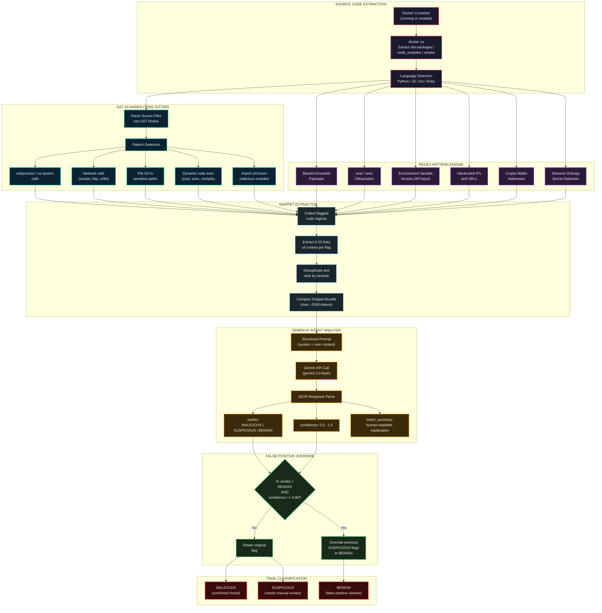

# Deep Static Analysis & AI Intent Verification

> The "funnel architecture" that narrows gigabytes of container source code down to compact suspicious snippets, then asks Gemini AI to determine whether the code is truly malicious.

[](../README.md)
[](./01-system-overview.md)

---

## Funnel Architecture Diagram



---

## Stage Details

### 1. Source Code Extraction

Package source code is extracted directly from the Docker container filesystem using `docker cp`. The extractor targets known package installation directories:

| Language | Extraction Path |
|----------|-----------------|
| Python | `/usr/lib/python*/site-packages/<pkg>/` |
| Node.js | `/usr/local/lib/node_modules/<pkg>/`, `/app/node_modules/<pkg>/` |
| Ruby | `/usr/lib/ruby/gems/*/gems/<pkg>/` |
| Go | Compiled binaries (limited static analysis; focus on `go.sum` verification) |

### 2. AST Scanner (Tree-sitter)

The AST scanner uses [Tree-sitter](https://tree-sitter.github.io/) grammars to parse source code into abstract syntax trees, then walks the tree searching for specific node patterns that indicate potentially dangerous operations.

| Detection Pattern | AST Node Types | Risk Level |
|-------------------|----------------|------------|
| Process execution | `call_expression` targeting `subprocess`, `os.system`, `child_process.exec` | High |
| Network requests | `call_expression` targeting `socket.connect`, `urllib.request`, `http.get` | High |
| Sensitive file I/O | `call_expression` with path arguments matching `/etc/passwd`, `/etc/shadow`, `~/.ssh/` | Critical |
| Dynamic code execution | `call_expression` targeting `eval`, `exec`, `compile`, `Function()` | Critical |
| Suspicious imports | `import_statement` for `ctypes`, `cffi`, `mmap`, `pty` | Medium |

> [!NOTE]
> Tree-sitter provides **language-agnostic AST parsing** with grammars available for 100+ languages. This allows the scanner to handle polyglot images (e.g., a Python app with JavaScript build tools) without separate parser implementations.

### 3. Regex Pattern Engine

A parallel regex-based scanner catches patterns that AST analysis may miss (e.g., patterns inside string literals, comments used as data channels, or encoded payloads):

| Pattern | Regex Description | Example Match |
|---------|-------------------|---------------|
| **Base64 payloads** | Strings matching `[A-Za-z0-9+/]{40,}={0,2}` inside code | `exec(base64.b64decode("aW1wb3J0IG9z..."))` |
| **eval/exec obfuscation** | `eval\s*\(`, `exec\s*\(`, `Function\s*\(` with string concatenation | `eval("im" + "port" + " os")` |
| **Environment variable access** | `os\.environ`, `process\.env`, `ENV\[` accessing secrets | `os.environ['AWS_SECRET_ACCESS_KEY']` |
| **Hardcoded IPs** | IPv4 addresses not in RFC 1918 / loopback ranges | `socket.connect(("45.33.32.156", 4444))` |
| **Crypto wallet addresses** | Bitcoin (1/3/bc1), Ethereum (0x), Monero (4) patterns | `wallet = "bc1qxy2kgdygjrsqtzq2n0yrf..."` |
| **Shannon entropy secrets** | Strings with entropy > 4.5 bits/char and length >= 20 | `api_key = "a1B2c3D4e5F6g7H8i9J0kLmN"` |

### 4. Snippet Extraction (The Funnel Neck)

This is the critical stage that makes the architecture practical. Rather than sending entire package source trees to the AI, the snippet extractor:

1. **Collects** all flagged code regions from both the AST scanner and the regex engine.
2. **Extracts context** -- only 5-10 lines surrounding each flag (2-3 lines before, the flagged line, 2-5 lines after).
3. **Deduplicates** overlapping regions and merges adjacent flags.
4. **Ranks** snippets by the severity of the detection pattern.
5. **Caps** the total bundle at approximately 2,000 tokens (~1,500 words).

### 5. Gemini AI Intent Analysis

The compact snippet bundle is sent to **Google Gemini** (`gemini-2.0-flash`) with a structured system prompt that instructs the model to evaluate each snippet for malicious intent.

**Prompt Structure:**
```
SYSTEM: You are a cybersecurity analyst specialising in software supply
chain attacks. Analyse the following code snippets extracted from a
package installed in a Docker container. Each snippet was flagged by
an automated scanner for potentially dangerous patterns.

Determine whether the code is:
- MALICIOUS: Clearly designed to exfiltrate data, install backdoors,
  mine cryptocurrency, or perform other harmful actions.
- SUSPICIOUS: Contains patterns that could be harmful but may also
  have legitimate uses. Requires manual review.
- BENIGN: The flagged pattern has a clear legitimate purpose in context.

Respond in JSON: { "verdict": "...", "confidence": 0.0-1.0, "intent_summary": "..." }

USER: [Compact snippet bundle with file paths and flag reasons]
```

**Response Schema:**

| Field | Type | Description |
|-------|------|-------------|
| `verdict` | `string` | One of `MALICIOUS`, `SUSPICIOUS`, `BENIGN` |
| `confidence` | `float` | Model confidence from `0.0` to `1.0` |
| `intent_summary` | `string` | Human-readable explanation of what the code does and why the verdict was assigned |

### 6. False Positive Override

The AI's response feeds into a **false positive override gate**:

- If the AI returns `BENIGN` with confidence >= `0.85`, any previous `SUSPICIOUS` flags from the threat intelligence stage are downgraded to `BENIGN`.
- If the AI returns `MALICIOUS`, the package is escalated regardless of prior classifications.
- If the AI returns `SUSPICIOUS` or `BENIGN` with low confidence, the original flags are retained.

> [!WARNING]
> The AI override can only **downgrade** `SUSPICIOUS` to `BENIGN`. It cannot override a `MALICIOUS` verdict from the threat intelligence engine (Check 1-3). Confirmed malware from OSV MAL- or the blocklist always remains `MALICIOUS`.

---

## Why Not Send Full Source Code to the AI?

The funnel architecture exists for three critical reasons:

| Concern | Full Code Approach | Snippet Funnel Approach |
|---------|--------------------|-------------------------|
| **Cost** | A typical `node_modules` directory contains 50,000+ files. Sending all of them would cost hundreds of dollars in API tokens per scan. | Only flagged snippets are sent -- typically 500-2,000 tokens total. Cost per scan: fractions of a cent. |
| **Token Limits** | LLM context windows (even at 1M tokens) cannot hold entire dependency trees. Truncation would miss critical code. | Snippets are pre-selected by deterministic scanners that have already identified the most suspicious regions. |
| **Speed** | Full-code analysis would take minutes to hours per package. | Snippet analysis completes in 1-3 seconds per API call. The entire AI stage runs in under 30 seconds for a typical image. |
| **Accuracy** | LLMs perform worse on needle-in-a-haystack tasks when given massive inputs. Attention dilution reduces detection accuracy. | Pre-filtered snippets focus the AI's attention on exactly the code that matters, improving verdict quality. |

> [!TIP]
> The AST + Regex scanners serve as a high-recall, moderate-precision first pass. The AI serves as a high-precision second pass. Together, they achieve both high recall and high precision while keeping costs minimal.

---

## Related Documentation

| Document | Description |
|----------|-------------|
| [System Overview](./01-system-overview.md) | High-level pipeline architecture |
| [SBOM & Vulnerability](./02-sbom-and-vulnerability.md) | SBOM parsing and CVE scoring |
| [Threat Intelligence](./03-threat-intelligence.md) | Multi-database malicious package detection |
| [Runtime Monitoring](./05-runtime-monitoring.md) | Live container behavioural analysis |
