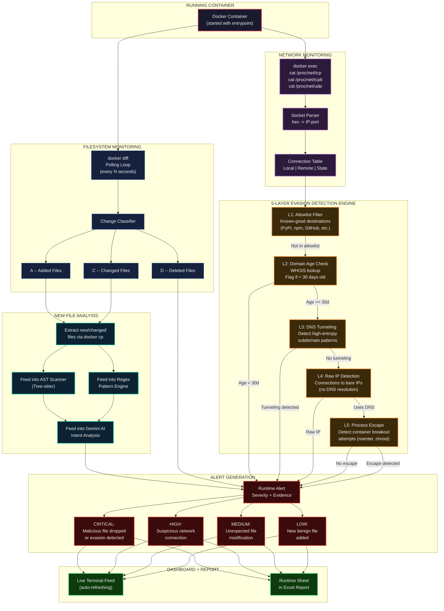
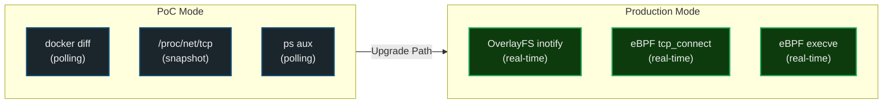

# Live Runtime Monitoring & Evasion Detection (HIDS)

> How Supply Chain Sentinel watches a running container for filesystem mutations, suspicious network activity, and evasion techniques -- functioning as a lightweight Host Intrusion Detection System.

[](../README.md)
[](./01-system-overview.md)

---

## Architecture Diagram



---

## Component Details

### 1. Filesystem Monitoring

The runtime monitor watches the container's filesystem for any changes that occur after startup. This catches malware that downloads additional payloads, modifies system files, or drops persistence mechanisms.

**Change Types Detected:**

| Code | Meaning | Security Implication |
|------|---------|----------------------|
| `A` | File or directory **added** | Dropped payload, downloaded second-stage malware, created cron job |
| `C` | File or directory **changed** | Modified library code (living-off-the-land), altered config files |
| `D` | File or directory **deleted** | Anti-forensics, evidence destruction, removing logs |

**New and changed files are automatically fed back into the full static analysis pipeline** (AST scanner + Regex engine + Gemini AI) to determine whether the runtime-created content is malicious.

### 2. Network Monitoring

Network connections are extracted by reading the kernel's connection tables from inside the container:

| Proc File | Protocol | Information |
|-----------|----------|-------------|
| `/proc/net/tcp` | TCP IPv4 | Local addr:port, remote addr:port, connection state |
| `/proc/net/tcp6` | TCP IPv6 | Same as above, IPv6 format |
| `/proc/net/udp` | UDP IPv4 | Local addr:port, remote addr:port |

The raw hex-encoded addresses are decoded into human-readable `IP:port` pairs and assembled into a connection table for analysis.

### 3. Five-Layer Evasion Detection Engine

Outbound network connections pass through a **five-layer detection cascade**. Each layer applies progressively deeper inspection:

```
Connection --> L1 Allowlist --> L2 Domain Age --> L3 DNS Tunneling --> L4 Raw IP --> L5 Process Escape
                  |                  |                  |                  |               |
              [PASS/FAIL]        [PASS/FAIL]        [PASS/FAIL]        [PASS/FAIL]     [PASS/FAIL]
```

---

#### Layer 1: Allowlist Filter

Known-good destinations are allowlisted to reduce noise. Connections to these destinations pass without further inspection:

| Category | Allowlisted Domains |
|----------|---------------------|
| Package Registries | `pypi.org`, `registry.npmjs.org`, `rubygems.org`, `proxy.golang.org` |
| Source Control | `github.com`, `gitlab.com`, `bitbucket.org` |
| Cloud Metadata | `169.254.169.254` (flagged separately as SSRF risk) |
| CDNs | `cdn.jsdelivr.net`, `unpkg.com`, `cdnjs.cloudflare.com` |
| DNS | `8.8.8.8`, `1.1.1.1`, `9.9.9.9` |

#### Layer 2: Domain Age Check

For connections to domains not in the allowlist, a WHOIS lookup determines the domain's registration age:

| Age | Action | Rationale |
|-----|--------|-----------|
| < 30 days | **FLAG** -- alert generated | Attackers frequently register fresh domains for C2 infrastructure |
| 30-90 days | **WARN** -- logged with notice | Young domains warrant monitoring |
| > 90 days | **PASS** -- proceed to L3 | Established domains are lower risk |

#### Layer 3: DNS Tunneling Detection

DNS tunneling encodes data in subdomain labels to exfiltrate information through DNS queries. The detector looks for:

| Indicator | Detection Method | Example |
|-----------|------------------|---------|
| High-entropy subdomains | Shannon entropy > 3.5 bits/char on subdomain labels | `a3f8b2c1d4e5.evil.com` |
| Unusually long subdomains | Label length > 30 characters | `aGVsbG8gd29ybGQgdGhpcyBpcyBhIHRlc3Q.evil.com` |
| Excessive subdomain depth | More than 4 levels of subdomains | `a.b.c.d.e.evil.com` |

#### Layer 4: Raw IP Detection

Connections to bare IP addresses (not resolved through DNS) are flagged because:

- Legitimate software almost always uses domain names.
- Raw IP connections bypass DNS-based security controls.
- C2 (Command and Control) infrastructure often uses direct IP addressing.

| Connection Type | Action |
|-----------------|--------|
| Public IP, no prior DNS lookup | **FLAG** -- high severity |
| Private IP (RFC 1918) | **PASS** -- internal networking |
| Loopback (127.0.0.0/8) | **PASS** -- local services |

#### Layer 5: Process Escape Detection

The final layer monitors for container breakout attempts:

| Technique | Detection | Severity |
|-----------|-----------|----------|
| `nsenter` execution | Process list monitoring | CRITICAL |
| `chroot` to host filesystem | File access pattern monitoring | CRITICAL |
| Mounting host paths | `/proc/mounts` inspection | CRITICAL |
| Capability abuse (`CAP_SYS_ADMIN`) | Capability enumeration | HIGH |
| Kernel exploit attempts | Suspicious syscall patterns (eBPF in production) | CRITICAL |

---

## PoC vs Production Approach

Supply Chain Sentinel supports two operational modes depending on the deployment environment:

### PoC Mode (Default -- No Kernel Modules Required)

| Component | Implementation | Limitation |
|-----------|----------------|------------|
| Filesystem monitoring | `docker diff` polling (configurable interval) | Polling delay; cannot capture transient files created and deleted between intervals |
| Network monitoring | `docker exec cat /proc/net/tcp` | Point-in-time snapshot; may miss short-lived connections |
| Process monitoring | `docker exec ps aux` | Polling-based; cannot capture rapid process spawning |
| Evasion detection | DNS resolution via Python `socket.getfqdn()`, WHOIS via `python-whois` | External API dependency for WHOIS; rate limits apply |

> [!NOTE]
> PoC mode is designed for **developer workstations and CI/CD pipelines** where installing kernel modules or requiring elevated privileges is not practical. It provides strong detection coverage with a small latency trade-off.

### Production Mode (Kernel-Level Monitoring)

| Component | Implementation | Advantage |
|-----------|----------------|-----------|
| Filesystem monitoring | **OverlayFS inotify** watches on the container's upper directory | Real-time, zero-delay file change detection including transient files |
| Network monitoring | **eBPF** probes on `tcp_connect`, `udp_sendmsg` | Captures every connection attempt, including failed ones |
| Process monitoring | **eBPF** probes on `execve` syscall | Captures every process spawn with full argument vectors |
| Evasion detection | **eBPF** seccomp-bpf integration | Kernel-level syscall filtering; no polling overhead |

> [!IMPORTANT]
> Production mode requires Linux kernel >= 5.8 with BPF CO-RE support, and the monitoring agent must run with `CAP_SYS_ADMIN` or as root. This mode is intended for **dedicated security scanning infrastructure** where the monitoring host is trusted.

### Comparison Summary



> [!TIP]
> For most use cases (pre-deployment scanning in CI/CD), PoC mode provides sufficient detection coverage. Upgrade to production mode only when deploying as a persistent runtime security monitor on container orchestration platforms (Kubernetes, ECS, etc.).

---

## Alert Severity Matrix

| Trigger | Severity | Example |
|---------|----------|---------|
| Malicious file dropped (AI confirmed) | CRITICAL | Python script with Base64-encoded reverse shell added to `/tmp/` |
| Container escape attempt detected | CRITICAL | `nsenter --target 1 --mount` executed |
| Connection to domain < 30 days old | HIGH | Outbound HTTPS to `fresh-c2-domain.xyz` registered 5 days ago |
| DNS tunneling pattern detected | HIGH | High-entropy subdomain queries to `data.exfil-server.com` |
| Raw IP connection (non-RFC1918) | HIGH | TCP connection to `45.33.32.156:4444` |
| Unexpected file modification | MEDIUM | `/usr/lib/python3/site-packages/requests/__init__.py` changed |
| File deleted after execution | MEDIUM | `/tmp/payload.sh` created, executed, then removed |
| New benign file added | LOW | Log file created in expected directory |

---

## Related Documentation

| Document | Description |
|----------|-------------|
| [System Overview](./01-system-overview.md) | High-level pipeline architecture |
| [SBOM & Vulnerability](./02-sbom-and-vulnerability.md) | SBOM parsing and CVE scoring |
| [Threat Intelligence](./03-threat-intelligence.md) | Multi-database malicious package detection |
| [Static Analysis & AI](./04-static-analysis-and-ai.md) | Code-level threat analysis and AI verification |
