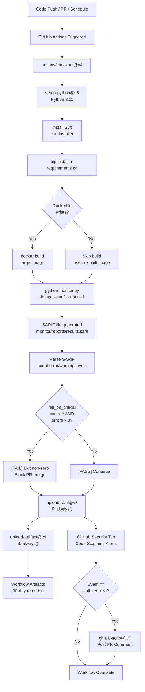

# CI/CD Integration Guide

This guide explains how to integrate Supply Chain Sentinel into your GitHub Actions workflows to automate software supply chain security scanning on every push, pull request, or schedule.

---

## Table of Contents

1. [Prerequisites](#prerequisites)
2. [Setting Up the GEMINI_API_KEY Secret](#setting-up-the-gemini_api_key-secret)
3. [Usage Examples](#usage-examples)
   - [Minimal Setup](#minimal-setup)
   - [Full Configuration](#full-configuration)
   - [Reusable Workflow](#reusable-workflow)
4. [Understanding SARIF Output in GitHub Security Tab](#understanding-sarif-output-in-github-security-tab)
5. [Configuring fail_on_critical as a PR Gate](#configuring-fail_on_critical-as-a-pr-gate)
6. [Complete Example Workflow](#complete-example-workflow)
7. [CI/CD Integration Flow](#cicd-integration-flow)
8. [Troubleshooting](#troubleshooting)

---

## Prerequisites

- A GitHub repository with a Dockerfile (or a pre-built Docker image accessible from the runner)
- GitHub Actions enabled for your repository
- A Gemini API key (for AI-powered analysis)
- The Supply Chain Sentinel `monitor/` directory present in the repository (or referenced via the composite action)

---

## Setting Up the GEMINI_API_KEY Secret

The Gemini API key is used to power the AI analysis layer of Supply Chain Sentinel. To add it to your repository:

1. Navigate to your repository on GitHub.
2. Click **Settings** > **Secrets and variables** > **Actions**.
3. Click **New repository secret**.
4. Set the name to `GEMINI_API_KEY` and paste your API key as the value.
5. Click **Add secret**.

> [!IMPORTANT]
> Never hard-code your API key in workflow files. Always reference it as `${{ secrets.GEMINI_API_KEY }}`. Secrets are masked in logs automatically by GitHub Actions.

For organization-wide usage, you can also set this as an **organization secret** and grant access to specific repositories.

---

## Usage Examples

### Minimal Setup

The simplest way to start — just pass your image name. This scans `my-app:latest` with default settings and uploads findings to the Security tab.

```yaml
# .github/workflows/security.yml
name: Security Scan

on:
  push:
    branches: [main]
  pull_request:
    branches: [main]

jobs:
  scan:
    runs-on: ubuntu-latest
    permissions:
      contents: read
      security-events: write
    steps:
      - uses: actions/checkout@v4
      - name: Build image
        run: docker build -t my-app:latest .
      - uses: vighnesh/supply-chain-sentinel@main
        with:
          image_name: 'my-app:latest'
          gemini_api_key: ${{ secrets.GEMINI_API_KEY }}
```

---

### Full Configuration

Use all available inputs for precise control over scanning behavior:

```yaml
# .github/workflows/security.yml
name: Supply Chain Security

on:
  push:
    branches: [main, develop]
  pull_request:
    branches: [main]
  schedule:
    - cron: '0 6 * * 1'  # Every Monday at 6 AM UTC

permissions:
  contents: read
  security-events: write
  actions: read

jobs:
  sentinel-scan:
    runs-on: ubuntu-latest
    steps:
      - uses: actions/checkout@v4

      - uses: vighnesh/supply-chain-sentinel@main
        with:
          image_name: 'my-app:latest'
          dockerfile_path: 'docker/Dockerfile.prod'
          docker_context: '.'
          include_os: 'true'          # Scan OS packages too
          fail_on_critical: 'true'    # Block PRs on critical findings
          gemini_api_key: ${{ secrets.GEMINI_API_KEY }}
          sarif_output: 'sentinel.sarif'
          report_dir: './sentinel-reports'

      - uses: actions/upload-artifact@v4
        if: always()
        with:
          name: sentinel-reports
          path: ./sentinel-reports/
          retention-days: 30
```

---

### Reusable Workflow

If your organization manages multiple repositories, you can call the Supply Chain Sentinel reusable workflow from a central security repository:

```yaml
# In your application repository: .github/workflows/security.yml
name: Security Scan (Reusable)

on:
  push:
    branches: [main]
  pull_request:
    branches: [main]

jobs:
  sentinel:
    uses: vighnesh/supply-chain-sentinel/.github/workflows/sentinel-reusable.yml@main
    with:
      image_name: 'my-app:latest'
      include_os: 'false'
      fail_on_critical: 'true'
    secrets:
      GEMINI_API_KEY: ${{ secrets.GEMINI_API_KEY }}
```

> [!TIP]
> The reusable workflow approach is ideal for enforcing consistent security policies across an organization. Pin to a specific release tag (e.g., `@v1.2.0`) instead of `@main` for stability in production environments.

---

## Understanding SARIF Output in GitHub Security Tab

Supply Chain Sentinel outputs results in [SARIF 2.1.0](https://docs.oasis-open.org/sarif/sarif/v2.1.0/sarif-v2.1.0.html) format, which GitHub natively understands.

### How to View Results

After a successful workflow run:

1. Go to your repository on GitHub.
2. Click the **Security** tab.
3. Click **Code scanning alerts** in the left sidebar.
4. You will see a list of findings from `supply-chain-sentinel`.

### Alert Levels

| SARIF Level | GitHub Label | Meaning |
|-------------|--------------|---------|
| `error`     | Critical / High | Must-fix vulnerabilities; will block PRs if `fail_on_critical: true` |
| `warning`   | Medium       | Should be reviewed and remediated |
| `note`      | Low / Info   | Informational findings |

### Alert Details

Each alert shows:
- **Rule ID** — the CVE or advisory identifier
- **Affected package** — name and version
- **Message** — AI-generated description and remediation advice (when Gemini API key is provided)
- **Location** — file or layer where the vulnerable package was found
- **Dismissal options** — mark as false positive, won't fix, or used in tests

> [!NOTE]
> Alerts are automatically **deduplicated** across runs. When a vulnerability is fixed, its alert is automatically closed. Historical alert data is retained for audit purposes.

---

## Configuring fail_on_critical as a PR Gate

To enforce a hard security gate on pull requests, set `fail_on_critical: 'true'` (which is the default). This causes the workflow to exit with a non-zero status code if any `error`-level SARIF findings are detected.

### Setting Up Branch Protection

1. Go to **Settings** > **Branches**.
2. Click **Add branch protection rule** for your `main` branch.
3. Enable **Require status checks to pass before merging**.
4. Search for and add the `Dependency Audit` check.
5. Enable **Require branches to be up to date before merging**.

```
Branch protection rule for: main
[x] Require a pull request before merging
[x] Require status checks to pass before merging
    Required checks:
    - Supply Chain Sentinel / Dependency Audit
[x] Require branches to be up to date
```

> [!IMPORTANT]
> If you use `fail_on_critical: 'false'`, the workflow will always succeed even if critical vulnerabilities are found. Results will still be uploaded to the Security tab — only the PR-blocking behavior is disabled. This is useful for initial rollout periods.

### Gradual Rollout Strategy

```yaml
# Phase 1: Report only (no blocking)
fail_on_critical: 'false'

# Phase 2: Block on critical after team review
fail_on_critical: 'true'
```

---

## Complete Example Workflow

Here is a production-ready workflow file you can drop directly into your repository:

```yaml
# .github/workflows/security.yml
name: Supply Chain Security

on:
  push:
    branches:
      - main
      - master
  pull_request:
    branches:
      - main
      - master
  schedule:
    - cron: '0 6 * * 1'
  workflow_dispatch:

permissions:
  contents: read
  security-events: write
  actions: read

jobs:
  supply-chain-scan:
    name: Supply Chain Sentinel Scan
    runs-on: ubuntu-latest

    steps:
      - name: Checkout code
        uses: actions/checkout@v4
        with:
          fetch-depth: 0

      - name: Run Supply Chain Sentinel
        id: sentinel
        uses: vighnesh/supply-chain-sentinel@main
        with:
          image_name: 'my-app:latest'
          dockerfile_path: 'Dockerfile'
          docker_context: '.'
          include_os: 'false'
          fail_on_critical: 'true'
          gemini_api_key: ${{ secrets.GEMINI_API_KEY }}
          sarif_output: 'results.sarif'
          report_dir: './reports'

      - name: Upload reports
        if: always()
        uses: actions/upload-artifact@v4
        with:
          name: sentinel-reports-${{ github.run_number }}
          path: ./reports/
          retention-days: 30

      - name: Print summary
        if: always()
        run: |
          echo "Scan complete."
          echo "Error count: ${{ steps.sentinel.outputs.error_count }}"
          echo "SARIF file: ${{ steps.sentinel.outputs.sarif_path }}"
```

---

## CI/CD Integration Flow



---

## Troubleshooting

### Syft Not Found

**Symptom:** `syft: command not found` after the install step.

**Cause:** The install script writes to `/usr/local/bin` but it may not be on `PATH` in subsequent steps.

**Fix:** Add `/usr/local/bin` explicitly to `PATH`:
```yaml
- name: Add Syft to PATH
  shell: bash
  run: echo "/usr/local/bin" >> $GITHUB_PATH
```

Or verify installation:
```yaml
- name: Install Syft
  shell: bash
  run: |
    curl -sSfL https://raw.githubusercontent.com/anchore/syft/main/install.sh | sh -s -- -b /usr/local/bin
    export PATH="/usr/local/bin:$PATH"
    syft version
```

---

### Docker Daemon Not Available

**Symptom:** `Cannot connect to the Docker daemon at unix:///var/run/docker.sock`

**Cause:** The GitHub Actions runner does not have Docker available (e.g., on `macos-latest` with some runner configurations, or in restricted environments).

**Fix 1:** Use `ubuntu-latest` — Docker is pre-installed on GitHub-hosted Ubuntu runners.

**Fix 2:** If scanning a pre-built image from a registry, skip the build step entirely and pull the image:
```yaml
- name: Pull image from registry
  run: docker pull my-registry.io/my-app:latest
```

**Fix 3:** Use Docker-in-Docker (DinD) if running in a self-hosted Kubernetes environment:
```yaml
services:
  docker:
    image: docker:dind
    options: --privileged
```

---

### Gemini API Rate Limits

**Symptom:** `429 Too Many Requests` errors in the monitor output; AI analysis is skipped or degraded.

**Cause:** The Gemini API has per-minute and per-day request quotas.

**Fix 1:** Run the scheduled scan less frequently (e.g., weekly instead of daily).

**Fix 2:** The monitor degrades gracefully — if the API key is absent or rate-limited, it still produces a SARIF file with vulnerability data (without AI-enriched descriptions).

**Fix 3:** Use a dedicated API key for CI with higher quota limits. Request a quota increase in Google Cloud Console.

---

### SARIF Upload Fails

**Symptom:** `upload-sarif` step fails with `File not found` or schema validation errors.

**Cause:** The `monitor.py` run failed before producing the SARIF file, or the SARIF schema is malformed.

**Fix:** Ensure the `Run Supply Chain Sentinel` step has completed (check artifact logs). The `upload-sarif` step uses `if: always()` to still attempt upload. Check the SARIF structure manually:
```bash
python -c "import json; json.load(open('monitor/reports/results.sarif')); print('Valid JSON')"
```

---

### SARIF File Not Found on PR Comment Step

**Symptom:** `ENOENT: no such file or directory, open 'monitor/reports/results.sarif'` in the PR comment script.

**Cause:** The audit step failed before writing the SARIF file and the PR comment step still runs due to `if: always()`.

**Fix:** Add a null-safe fallback in the github-script (already included in the main workflow). The script catches exceptions and defaults counts to `0`.
