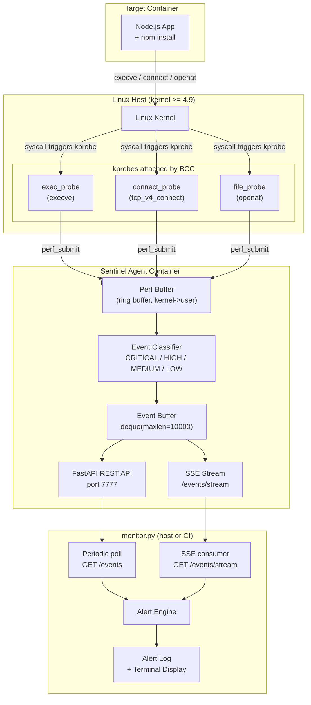

# 07 -- eBPF Runtime Monitoring

## 1. Overview

### The Limits of Polling-Based Monitoring

The original `monitor.py` used two polling techniques for runtime visibility:

- **`docker diff`** -- compares the container filesystem snapshot to its base image. It only fires after files are already written, with a multi-second delay, and misses transient in-memory activity entirely.
- **`/proc/net/tcp` parsing** -- reads the kernel's TCP connection table at periodic intervals. Connections that open and close between polls are invisible.

These approaches share a fundamental problem: they observe **state snapshots**, not **events**. An attacker who exfiltrates data or spawns a reverse shell and exits within a poll window leaves no trace.

### What eBPF Changes

Extended Berkeley Packet Filter (eBPF) is a Linux kernel subsystem that lets verified programs run inside the kernel, triggered by any system call or kernel function. For security monitoring this means:

- **Zero-miss coverage** -- every `execve()` call, every `connect()`, every `open()` fires our probe at the moment it happens.
- **Kernel-native** -- no sampling, no race conditions with process lifetimes.
- **Low overhead** -- benchmarks consistently show **<1% CPU** and sub-microsecond probe latency per event.
- **Rich context** -- PID, PPID, UID, timestamp, comm, filename, and socket addresses are all available in the kernel's execution context.

> [!NOTE]
> eBPF programs are loaded into the kernel via BCC (BPF Compiler Collection) and attached as **kprobes** -- dynamic breakpoints on kernel functions. The BPF verifier rejects any program that could crash or hang the kernel, so the technique is safe for production use.

### Two Operational Modes

| Mode | When Active | Source of Events |
|---|---|---|
| **eBPF mode** | Linux kernel >= 4.9, BCC installed, `CAP_SYS_ADMIN` | kprobe callbacks via perf ring buffer |
| **Fallback mode** | Windows, macOS, or Linux without BCC | `docker top` polling every 5 seconds |

The agent advertises its mode via the `/health` endpoint (`"mode": "ebpf"` or `"mode": "fallback"`). `monitor.py` reads this and adjusts its alert thresholds accordingly.

---

## 2. Architecture



---

## 3. What Each Probe Detects

| Probe | Syscall | What It Catches | Example Attack |
|---|---|---|---|
| `exec_probe` | `execve` | Shell spawning, package installation, interpreter invocation | `curl \| sh` reverse shell, `pip install` of backdoored package |
| `connect_probe` | `tcp_v4_connect` | Outbound C2 connections, data exfiltration, DNS-over-TCP | Data sent to `185.x.x.x:4444`, beacon to attacker C2 |
| `file_probe` | `openat` | Credential file access, config tampering, secret theft | Reading `/.aws/credentials`, writing to `/etc/cron.d/` |

### Severity Classification

Events are classified at the moment they are emitted from the perf buffer:

| Severity | Examples |
|---|---|
| `CRITICAL` | `curl`/`wget` with HTTP args (active download), file write to sensitive paths |
| `HIGH` | Shell spawn, package manager invocation, outbound connection to public IP |
| `MEDIUM` | Outbound connection to private/internal IP, new process in monitored container |
| `LOW` | All other events that pass filter thresholds |

---

## 4. Deployment Guide

### 4.1 System Requirements

- Linux kernel **4.9 or newer** (check: `uname -r`)
- `bpfcc-tools` and `python3-bpfcc` installed on the host (handled by the Dockerfile inside the container)
- Docker with support for **`--privileged`** containers
- The host user running `docker compose` must be in the `docker` group or be root

### 4.2 Build the Agent Image

```bash
docker compose --profile ebpf build sentinel-agent
```

The build installs BCC, LLVM, Clang, and the Linux kernel headers from the Ubuntu 22.04 repositories. Build time is approximately 3-5 minutes on a cold layer cache.

### 4.3 Start the Agent

```bash
docker compose --profile ebpf up sentinel-agent -d
```

The `ebpf` profile ensures the agent is **not** started during a plain `docker compose up`, preventing accidental privileged container launches in non-Linux environments.

### 4.4 Verify the Agent is Running

```bash
curl http://localhost:7777/health
```

Expected response on a Linux host with BCC:

```json
{
  "status": "ok",
  "mode": "ebpf",
  "kernel": "6.1.0-21-amd64",
  "bcc_available": true,
  "events_captured": 0,
  "monitoring_active": false
}
```

### 4.5 Start Monitoring via monitor.py

```bash
python monitor.py --container nexus-studio-app --watch --ebpf
```

The `--ebpf` flag makes `monitor.py` instantiate `EBPFAgentClient` and call `POST /monitor/start` instead of using the polling-based runtime scanner.

### 4.6 Query Events Directly

```bash
# All events at HIGH severity or above
curl "http://localhost:7777/events?severity=HIGH"

# Events since a specific Unix timestamp
curl "http://localhost:7777/events?since=1728886000"

# Real-time stream (Ctrl-C to stop)
curl -N http://localhost:7777/events/stream
```

---

## 5. Security Considerations

### Why `--privileged` Is Required

Loading eBPF programs and attaching kprobes requires `CAP_SYS_ADMIN` (or the more granular `CAP_BPF` + `CAP_PERFMON` on kernels 5.8+). Docker's `--privileged` flag grants all capabilities and disables seccomp/AppArmor confinement. This is a significant privilege escalation from the container's perspective.

**Mitigations applied in this implementation:**

- The agent container mounts `/sys`, `/proc`, `/lib/modules`, and `/usr/src` **read-only**. It cannot modify the host filesystem through these mounts.
- The `network_mode: host` and `pid: host` settings are required so that the kprobes can observe activity from other containers. Without host PID namespace, the agent would only see its own processes.
- The agent listens only on `localhost:7777` by default; expose it externally only within a trusted network.

### CAP_BPF vs CAP_SYS_ADMIN (Kernel 5.8+)

Linux 5.8 introduced the `CAP_BPF` and `CAP_PERFMON` capabilities, which allow eBPF program loading and perf event access without the full `CAP_SYS_ADMIN`. A production hardening step would be to drop `--privileged` and instead use:

```yaml
cap_add:
  - CAP_BPF
  - CAP_PERFMON
  - CAP_SYS_PTRACE    # for reading /proc/<pid>/ entries
```

This PoC uses `--privileged` for simplicity and broader kernel version compatibility (4.9+).

### Why Host PID Namespace

Without `--pid=host`, the agent's kprobes would fire for all processes system-wide but the `/proc/<pid>/` entries visible inside the container would be scoped to its own PID namespace. Host PID namespace is needed to resolve PIDs from kprobe events back to their container context via `/proc/<pid>/cgroup`.

### Production Alternatives

If `--privileged` is not acceptable in your environment, consider these purpose-built agents that use CO-RE eBPF or dedicated kernel modules:

| Tool | Approach | Privilege Model |
|---|---|---|
| [Falco](https://falco.org) | eBPF or kernel module | `CAP_BPF` + `CAP_PERFMON` |
| [Tetragon](https://tetragon.io) | CO-RE eBPF (Cilium) | `CAP_BPF` + `CAP_PERFMON` |
| [Pixie](https://pixielabs.ai) | eBPF + EBPF CO-RE | `--privileged` |

---

## 6. PoC vs. Production

| Aspect | PoC (This Implementation) | Production-Grade |
|---|---|---|
| Attach method | kprobes via BCC (JIT-compiled at load time) | CO-RE eBPF with BTF type information |
| Container attribution | `/proc/PID/cgroup` parsed in userspace | cgroupv2 BPF maps queried in-kernel |
| Kernel requirement | 4.9+ | 5.8+ (for `CAP_BPF`, BTF, CO-RE) |
| CPU overhead | < 2% | < 0.5% |
| Portability | Requires kernel headers on the host | BTF-enabled kernel (no headers needed) |
| Missing events | Perf buffer can drop under high event rate | Use BPF ring buffer (kernel 5.8+) |
| Process filtering | Userspace filter after event emission | In-kernel BPF map for container PID sets |
| Alternatives | -- | Falco, Tetragon, Cilium, Pixie |

> [!TIP]
> CO-RE (Compile Once -- Run Everywhere) eBPF programs embed BTF relocation information so they do not need kernel headers at runtime. This is the standard approach for distributing eBPF-based agents as containers.

---

## 7. Troubleshooting

### `ModuleNotFoundError: No module named 'bcc'`

BCC Python bindings are not available. Inside the agent container this should not occur because the Dockerfile installs `python3-bpfcc` via apt. Outside the container (e.g. running `agent.py` directly on macOS or Windows), the agent will automatically fall back to docker-top polling mode.

```bash
# Verify BCC is installed inside the container
docker exec sentinel-agent python3 -c "import bcc; print(bcc.__version__)"
```

### `Operation not permitted` (errno 1) When Loading eBPF

The container does not have sufficient privileges to call `bpf()`.

- Ensure the container is started with `--privileged` or with `CAP_BPF` + `CAP_PERFMON`.
- Verify `docker inspect sentinel-agent | grep Privileged` returns `true`.

### `Cannot open BPF map: No such file or directory`

The kernel is older than 4.9, or the BPF filesystem is not mounted.

```bash
# Check kernel version
uname -r

# Mount bpffs if missing
mount -t bpf bpf /sys/fs/bpf
```

### `Agent unreachable` from monitor.py (`EBPFAgentClient.is_available()` returns False)

1. Check the agent is running: `docker compose --profile ebpf ps`
2. Check agent logs: `docker compose --profile ebpf logs sentinel-agent`
3. Confirm the port is exposed: `curl http://localhost:7777/health`
4. If using `network_mode: host`, ensure no firewall is blocking port 7777.

### Perf Buffer Event Drops

Under very high syscall rates (e.g., a tight loop calling `execve()`), the perf ring buffer may drop events. Symptoms: the agent logs `"lost X events"` from the BCC callback.

- Increase the perf buffer page count in the BPF program (`open_perf_buffer(page_cnt=64)`).
- Add in-kernel filtering to reduce the event rate (e.g., only emit `exec_events` for UIDs matching the container's user).
