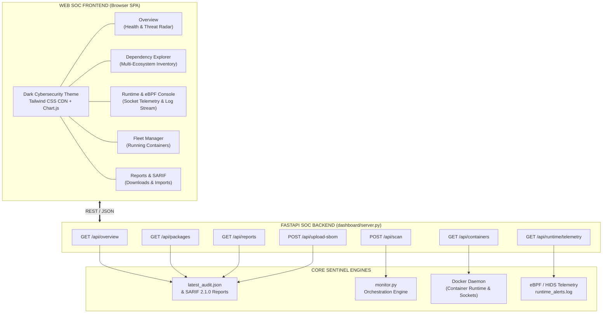

# Web Dashboard & Security Operations Center (SOC)

> **Supply Chain Sentinel** — Centralized Web Dashboard & Real-Time Threat Intelligence Console.

[](../README.md)

---

## 1. Overview

**Supply Chain Sentinel Web Dashboard** provides an interactive, browser-based Security Operations Center (SOC) console designed for DevSecOps, AppSec, and incident response teams. While the command-line interface provides color-coded terminal outputs and CI/CD automation generates OASIS SARIF 2.1.0 records, the Web SOC Dashboard aggregates findings into a centralized, live pane of glass.

Key capabilities include:
- **Health / Compliance Scoring**: Real-time 0–100 compliance metric with dynamic risk penalty deductions.
- **Granular Multi-Ecosystem Dependency Explorer**: Instant search and filtering across npm, PyPI, Go, RubyGems, Maven, and OS packages with live CVSS vector scoring.
- **Deep Forensics Modal**: Interactive AST code analysis inspect view (Tree-sitter line highlights, high-entropy secrets, crypto wallet addresses, outbound C2 destinations, and Google Gemini AI intent explanations).
- **Live Runtime & eBPF Telemetry Console**: Real-time inspection of active container TCP/UDP sockets and a streaming HIDS alert log.
- **Container Fleet Management**: Live Docker daemon introspection, probing container runtimes and offering 1-click on-demand audits.
- **OASIS SARIF 2.1.0 & CycloneDX Ingestion**: Upload custom SBOMs or SARIF files to instantly visualize security posture, or download historical Excel workbooks.

---

## 2. Architecture & Data Flow

The dashboard operates via a decoupled architecture: a high-performance **FastAPI** backend that interfaces directly with Sentinel's scanners, OSV threat databases, and Docker runtimes, paired with a lightweight, responsive **Tailwind CSS + Chart.js** single-page frontend.



---

## 3. Dashboard Views & Features

### 3.1 SOC Overview & Executive Metrics
- **Compliance Health Score (0-100)**: Evaluates aggregate risk across dependencies. Calculates penalty weights (Malicious implants: -25, Critical CVEs: -15, High: -8, Medium: -3).
- **Metric Summary Cards**: Total packages scanned, Critical/High counts, Malicious implant count, Shannon secrets, Crypto wallets, and Monitored fleet count.
- **Severity & Ecosystem Radar**: Chart.js doughnut chart breaking down findings by CVSS v3.1 tier alongside dependency distribution across npm, PyPI, Go, etc.
- **Top Threats Spotlight**: Real-time table surfacing packages flagged with malicious implants, AST zero-day IOCs, or critical CVEs.

### 3.2 Dependency & Vulnerability Explorer
- Full-text search matching package names, CVE identifiers (`CVE-2024-xxxx`, `MAL-xxxx`), or threat intelligence sources.
- Filter by Ecosystem (npm, PyPI, Go, RubyGems, crates.io, Maven) and Severity level.
- "Threats Only" quick toggle isolating at-risk packages.
- Interactive table detailing current vs. latest registry version, CVSS v3.1 scores, detected IOCs, and Gemini AI semantic verdicts.
- **Inspect Action**: Opens the Deep Forensics Modal displaying raw AST snippets, extracted API keys, cryptocurrency wallets, and Gemini AI analysis rationale.

### 3.3 Live Runtime & eBPF Telemetry Feed
- Real-time container network socket table inspecting `/proc/net/tcp` with automated package attribution (identifying which dependency initiated outbound traffic).
- Risk classification for outbound connections: `SUSPICIOUS_PORT`, `RAW_IP`, `PRIVATE`, `NORMAL`.
- Streaming terminal alert console displaying live events from `runtime_alerts.log` and `runtime_alerts_ebpf.log` (L1-L5 evasion attempts, reverse shells, C2 callbacks).

### 3.4 Container Fleet Management
- Queries the Docker daemon to introspect active containers.
- Identifies detected language runtimes inside each container (Node.js, npm, Python, Go, etc.).
- 1-click **Scan This Container** button to trigger background security audits without touching the terminal.

### 3.5 Reports & Compliance Exports
- Lists all historical `.xlsx` audit reports, `.sarif` code scanning files, and `.json` bills of materials.
- One-click downloads served directly via FastAPI `FileResponse`.
- Ingestion modal supporting drag-and-drop upload of external CycloneDX JSON or SARIF 2.1.0 files.

---

## 4. REST API Endpoint Reference

| Method | Endpoint | Description |
|---|---|---|
| `GET` | `/` | Serves the primary single-page cybersecurity dashboard application |
| `GET` | `/api/overview` | Returns aggregate metrics, health score, ecosystem counts, and eBPF capabilities |
| `GET` | `/api/packages` | Returns dependency list with filtering (`search`, `ecosystem`, `severity`, `threats_only`) |
| `GET` | `/api/containers` | Introspects Docker daemon for running containers and detected language runtimes |
| `GET` | `/api/runtime/telemetry` | Retrieves active container sockets and recent HIDS / eBPF alert logs |
| `GET` | `/api/reports` | Lists all generated audit workbooks, SARIF files, and JSON exports |
| `GET` | `/api/reports/{filename}/download` | Downloads a specific report file |
| `POST` | `/api/scan` | Dispatches a background audit scan for a target Docker image or container |
| `GET` | `/api/scan/{job_id}/status` | Streams execution progress and terminal logs for a background scan |
| `POST` | `/api/upload-sbom` | Ingests external CycloneDX JSON or SARIF 2.1.0 files into the dashboard |

---

## 5. Usage & Launch Instructions

### Launching Standalone
Start the dashboard directly on port 8080:
```bash
python dashboard/server.py --port 8080
```
Then navigate to `http://localhost:8080` in your web browser.

### Launching via Sentinel CLI
Run a security audit on a target container and immediately open the dashboard:
```bash
# Scan container and launch dashboard
python monitor/monitor.py --container nexus-studio-app --dashboard

# Or launch dashboard directly without scanning
python monitor/monitor.py --dashboard-only --dashboard-port 8080
```

### Accessing Interactive REST API Documentation
FastAPI provides automatic interactive OpenAPI / Swagger UI:
- **Swagger UI**: `http://localhost:8080/docs`
- **ReDoc**: `http://localhost:8080/redoc`
